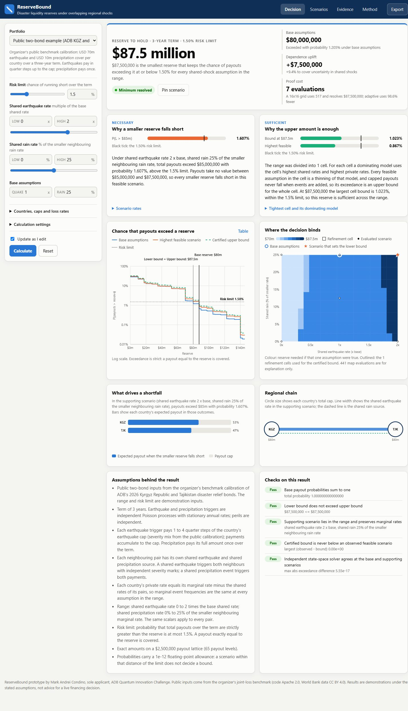
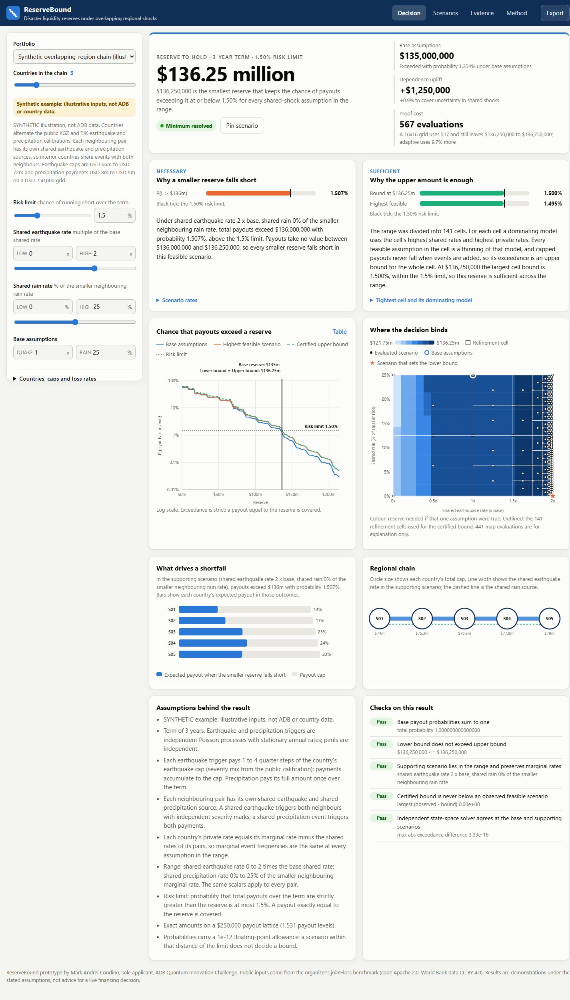

# Disaster liquidity reserves

Prototype for **Sizing Disaster Liquidity Reserves under Overlapping Regional Shocks**
(ADB Quantum Innovation Challenge). Mark Andrei Condino is the sole applicant and is
responsible for the entire project.

A regional disaster pool must decide how much cash to hold when several countries may
claim at once. Given country loss rates, payout caps, a range of shared earthquake and
rain rates, and a limit on the chance of running short, the engine returns the smallest
reserve that meets the limit across the whole range. When the minimum is not resolved
within the calculation budget it returns lower and upper bounds. It also shows a feasible
scenario in which a smaller reserve falls short and explains why the upper amount is
sufficient.

- **Engine** (`src/liquidity_reserves`): capped payout model; quantum-inspired
  tensor-network (matrix-product) contraction on a CPU with exact monetary amounts;
  adaptive refinement of reserve bounds; an independent state-space solver for checks.
- **Benchmark worker** (`worker.py`): the organizer's evaluation-v1 request/result
  contract as a `classical_cpu` entry for both public tracks.
- **ReserveBound app** (`python -m liquidity_reserves.app`): a local decision dashboard
  with live inputs, the evidence behind each bound, scenario comparison, the benchmark
  record, a method page with the quantum amplitude-estimation check, and a PDF report.



## What is in this repository

| Item | Where |
|---|---|
| Source code | `src/liquidity_reserves/` (engine, app, quantum check, validation), `worker.py`, `scripts/`, `tests/` |
| Environment specifications and dependencies | `pyproject.toml`, `requirements.txt`, `requirements-dev.txt`, `requirements-quantum.txt`; [Environment and hardware](#environment-and-hardware) |
| Setup and execution instructions | This README: [Setup](#setup), [Run the app](#run-the-app), [Test](#test), [Run the official benchmark](#run-the-official-benchmark) |
| Hardware and simulator details | [Environment and hardware](#environment-and-hardware) |
| Sample results and outputs | [`results/`](results) and [Sample outputs](#sample-outputs) |

## Setup

Python 3.10 or later. From the repository folder:

```sh
python -m venv .venv
# Windows: .venv\Scripts\activate    Linux/macOS: source .venv/bin/activate
python -m pip install -r requirements-dev.txt
python -m pip install -e .
```

`requirements.txt` pins the versions used for the recorded results (numpy 1.26.4,
scipy 1.15.3). The app uses only the Python standard library on top of those. For the
optional circuit resource counts, also run
`python -m pip install -r requirements-quantum.txt`.

## Run the app

```sh
python -m liquidity_reserves.app --open
```

The app serves `http://127.0.0.1:8765/` on the local machine only. It preloads the
public two-bond example; a clearly labelled synthetic overlapping-region chain (2 to 20
countries) is in the portfolio menu. Results update as inputs change (up to 10
countries; longer chains use the Calculate button).

| View | What it shows |
|---|---|
| Decision | Reserve to hold, base reserve, dependence uplift and proof cost; why a smaller reserve falls short and why the upper amount is enough; exceedance curves; a map of the reserve needed across the shared-shock range with the refinement cells; each country's share of a shortfall; the regional chain; assumptions and live checks |
| Scenarios | Reserve against the risk limit, and pinned scenarios compared side by side |
| Evidence | Official evaluator results against the organizer's classical baselines, every proposal figure recomputed, evaluation counts and scaling |
| Method | How the model, contraction and bounds work; amplitude estimation of P(payout > reserve) on an ideal simulator against Monte Carlo; quantum resource counts |

Export offers a print-ready PDF report (A4, through the browser's Save as PDF), JSON
data and a Markdown summary. Each contains the inputs, the reserve bounds, the
supporting scenario and the validation status.

## Test

```sh
python -m pytest              # all tests
python -m pytest -m "not slow"
ruff check . && ruff format --check .
```

## Quantum amplitude-estimation check

```sh
python -m pip install -e ".[quantum]"   # Qiskit, only needed to compile circuits
python -m liquidity_reserves.quantum    # writes results/quantum.json
```

A payout register holds the aggregate payout law, a flag marks payouts above the
reserve, and maximum-likelihood amplitude estimation recovers P(payout > reserve) from
Grover-amplified counts. It runs as an ideal noiseless statevector simulation on the CPU
and compares query counts with Monte Carlo. The law is loaded from the classical
contraction, so this checks the estimator, its query scaling and the circuit resources
(qubits, CX count, depth) for a hardware run; it is not a speed-up claim. The app runs the
simulation without Qiskit; Qiskit is used only for the compiled resource counts.

## Validate the proposal figures

```sh
python -m liquidity_reserves.validation          # writes results/validation.json and .md
python -m liquidity_reserves.validation --quick  # skips the 10- and 20-country rows
```

Every figure is recomputed by the engine and compared with the technical proposal.
[`results/validation.md`](results/validation.md) lists each target, the computed value
and any discrepancy.

## Run the official benchmark

The organizer's evaluator needs Linux or macOS (WSL works on Windows). Install the
pinned dependencies and the vendored, unmodified benchmark package into the interpreter
the evaluator will use, then run both suites:

```sh
python -m pip install -r requirements.txt ./benchmark
PYTHON=python scripts/run_benchmark.sh runs/benchmark
```

The script verifies `benchmark/SHA256SUMS`, packages the seven public scenarios as a
suite, generates the six seeded practice cases (`qjlb holdout --seed 20261113`), and runs
`qjlb evaluate ... --execution classical_cpu --trusted-code -- python worker.py` with 10
repeats on each. Reports and timings stay in the evaluator output (`report.json`,
`summary.csv`); `summary.json` counts passes and failures. Recorded results are in
[`results/benchmark`](results/benchmark).

The worker can also be called directly:

```sh
python worker.py --request request.json --output result.json
```

## Recorded results

| Check | Result |
|---|---|
| Official evaluator, 7 public + 6 practice cases, 10 repeats | 13/13 cases, 65/65 metric checks, 130/130 runs valid |
| Two-bond base reserve, 1.5% three-year limit | USD 80m |
| Two-bond reserve across the dependence range, 1.5% | USD 87.5m, 7 distribution evaluations |
| Two-bond reserve across the dependence range, 0.5% | USD 105m, 39 evaluations (16x16 grid: 517) |
| Synthetic chain, 5 / 10 / 20 countries, 1.5% | USD 136.25m / 191.25m-191.5m / 289m-290m |
| Contraction vs organizer's exact reference and independent state-space solver | agree to < 1e-15 |
| Amplitude estimation vs Monte Carlo, P(L > $80m), 103,200 queries (ideal simulator) | RMSE 2.8e-5 vs 3.4e-4 |

ADB targets are term probabilities and USD over the bond term; World Bank targets are
annual event rates and USD per year. They are computed and reported separately.

## Environment and hardware

**Hardware.** One CPU workstation: AMD Ryzen 5 9600X (6 cores, 12 threads), 31 GB RAM.
No GPU, no quantum hardware and no cloud service were used.

**Operating systems and Python.** Tests, validation, the app and the quantum check ran on
Windows 10 Pro with Python 3.12.10. The organizer's evaluator, which needs POSIX, ran
under WSL2 Ubuntu (Linux 6.18, glibc 2.39) with Python 3.12.3. CI runs the tests on
Ubuntu and Windows with Python 3.10 and 3.12.

**Dependencies.** Pinned versions used for every recorded result:

| File | Contents |
|---|---|
| `requirements.txt` | numpy 1.26.4, scipy 1.15.3 (the engine, worker and app need nothing else) |
| `requirements-dev.txt` | adds pytest 9.2.0 and ruff 0.17.5 |
| `requirements-quantum.txt` | adds Qiskit 2.2.3 and its dependencies, only to compile circuits for resource counts |
| `benchmark/pyproject.toml` | the organizer's package (`qjlb` 0.5.0), vendored unmodified |

**Classical computation.** The reserve engine, the benchmark worker and all recorded
reserve figures run on the CPU. The tensor-network contraction is the quantum-inspired
part. The benchmark entry is declared `classical_cpu` with zero shots and qubits.

**Simulator.** The amplitude-estimation check uses an ideal, noiseless statevector
simulation written in NumPy (`src/liquidity_reserves/quantum.py`): 6 qubits for the
public two-bond case and up to 14 qubits for 20 synthetic countries, with no noise model
and no error mitigation. Shot counts are drawn from the simulated probabilities with a
fixed seed (20261113). Resource counts come from the Qiskit 2.2.3 transpiler targeting
rz, sx, x and cx gates with all-to-all connectivity (optimization level 1, seed 7).

## Sample outputs

| File | What it is |
|---|---|
| [`results/samples/public-two-bond-1.5pct-report.pdf`](results/samples/public-two-bond-1.5pct-report.pdf) | PDF reserve report for the public two-bond example at the 1.5% limit |
| [`results/samples/synthetic-5-countries-1.5pct-report.pdf`](results/samples/synthetic-5-countries-1.5pct-report.pdf) | PDF reserve report for the synthetic five-country chain |
| [`results/samples/public-two-bond-1.5pct.json`](results/samples/public-two-bond-1.5pct.json), [`.md`](results/samples/public-two-bond-1.5pct.md) | JSON and Markdown exports of the same calculation |
| [`results/validation.md`](results/validation.md) | Every proposal figure recomputed, with discrepancies |
| [`results/benchmark/`](results/benchmark) | Official evaluator reports for the public and practice suites |
| [`results/quantum.json`](results/quantum.json) | Amplitude-estimation study and compiled resource counts |
| [`docs/screenshots/`](docs/screenshots) | The Decision, Scenarios, Evidence and Method views |



## Layout

```
src/liquidity_reserves/   engine, insights, quantum check, worker, validation, app
worker.py                 evaluation-v1 entry point for the organizer's evaluator
benchmark/                organizer's benchmark, vendored unmodified (see SHA256SUMS)
scripts/                  public-suite packaging, evaluator run, report summary
tests/                    pytest suite
results/                  recorded validation, evaluator and quantum-check reports
results/samples/          sample PDF reports and exports
docs/screenshots/         screenshots of the app
```

## Method notes

- Exceedance is strict: a payout exactly equal to the reserve is covered.
- Shared earthquake and precipitation sources sit on each neighbouring pair. Private
  rates equal marginal rates minus incident shared rates, so marginals stay fixed.
- Lower bound: a feasible scenario (range corner, cell centre or base point) whose
  exceedance is above the limit. Upper bound: per cell, a dominating model with the
  cell's highest shared and private rates bounds every feasible scenario in the cell.
- Public examples use exact amounts (integer quarter-cents). When the payout lattice
  would be too large, payouts are rounded down for feasible scenarios and up for
  dominating models, and the rounding bound is reported.
- One distribution evaluation is one aggregate payout distribution (one contraction).

## Licence

Copyright 2026 Mark Andrei Condino. Licensed under the Apache License 2.0
([`LICENSE`](LICENSE), [`NOTICE`](NOTICE)).

## Sources and licences

`benchmark/` is the organizer's joint-loss baseline: code under Apache 2.0
(`benchmark/LICENSE`), World Bank data under CC BY 4.0 (`benchmark/data/LICENSE.txt`,
`benchmark/data/source-manifest.json`). The public bond inputs cite ADB's 2026 offering
documents (`benchmark/data/adb_terms.json`). The organizer's `.gitignore` listed in
`SHA256SUMS` was not in the distributed copy; every other listed file matches.
